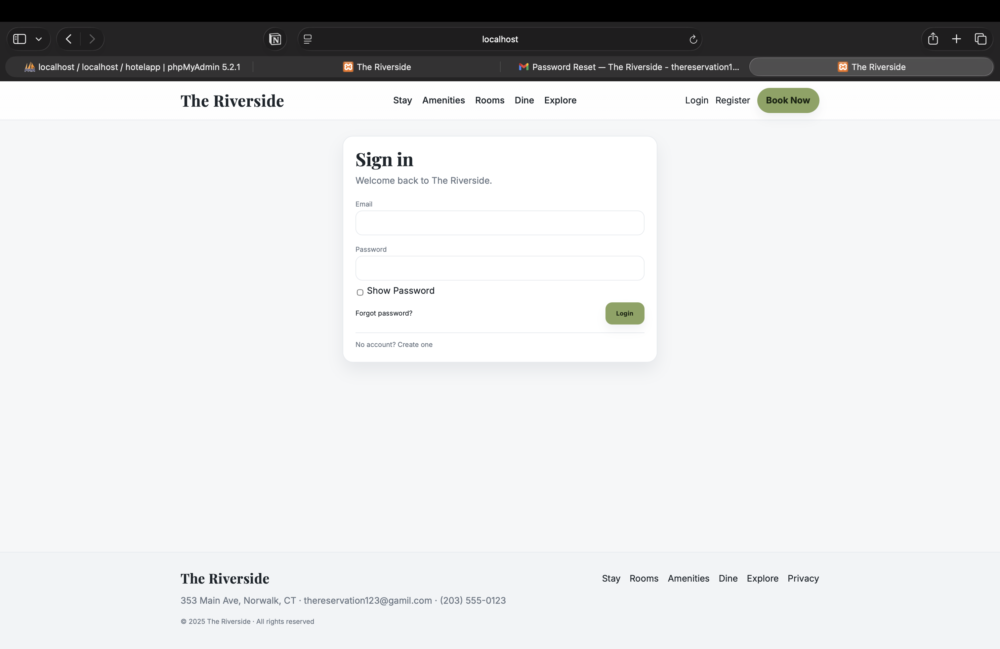
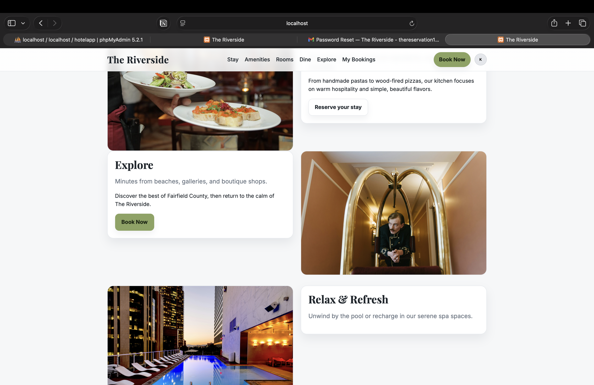
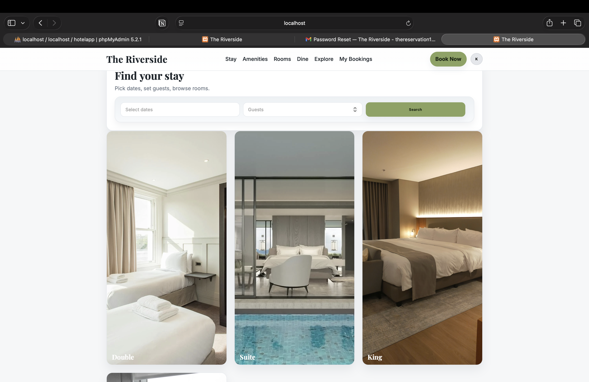
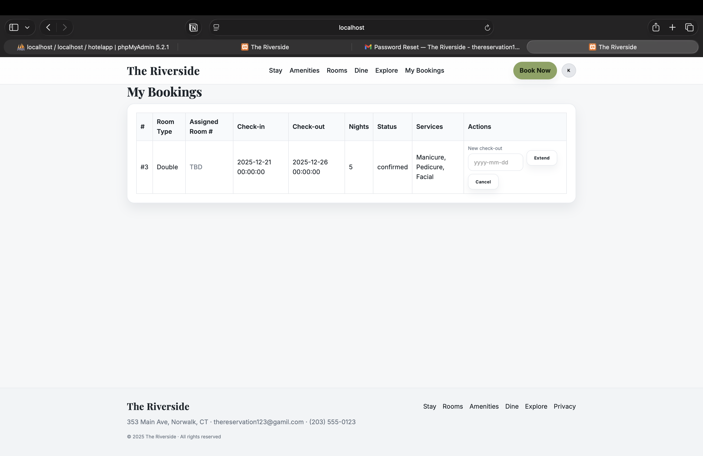
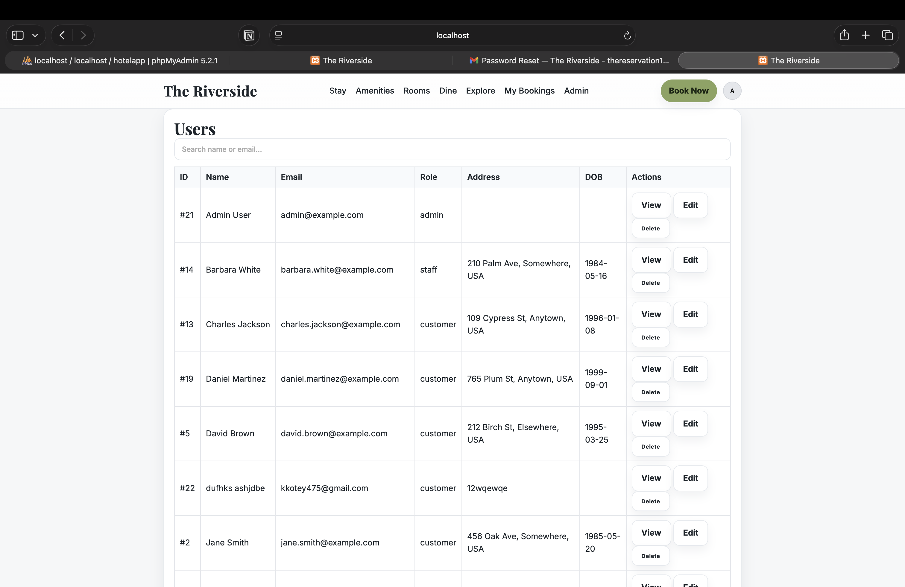

#  Hotel Management System

A full-stack hotel reservation and management system built with **PHP** and **MySQL**.  
Designed to streamline hotel operations with **multi-role authentication** for Guests, Staff, and Administrators.

---

##  Key Features

### Guest
- Secure registration and login
- Browse available rooms with pricing and amenities
- Book rooms with real-time availability
- View booking status (Pending / Confirmed)

### Staff
- View and manage incoming reservations
- Handle check-in and check-out workflows
- Access guest booking details for front-desk operations

### Admin
- Dashboard overview of system activity
- Manage room inventory (add, edit, delete, pricing)
- Approve, ban, or manage user accounts
- Configure system-wide settings

---

## Tech Stack
- **Backend:** PHP (Core)
- **Database:** MySQL
- **Frontend:** HTML5, CSS3, JavaScript
- **Email:** PHPMailer
- **Server:** Apache (XAMPP for local development)
- **Dependency Management:** Composer

---
## My Role
This was a team project. The original repository belongs to a teammate ([kkotey14/hotel-management-system](https://github.com/kkotey14/hotel-management-system)); this is my copy of the code.

I was responsible for the **back end and the database**:
- Designed the MySQL schema (`schema.sql`)
- Wrote the PHP logic for registration and login, room booking with real-time availability, the staff check-in/check-out dashboard, and the admin dashboard
- Used database transactions to prevent double-booking
- Added CSRF tokens to forms
- Built the password reset flow with PHPMailer

I also built several front-end pages to help the team stay on schedule: the room details page (`room.php`), My Bookings (`my_bookings.php`), and the user profile page (`profile.php`).

Because the repository belonged to a teammate, I developed and tested locally and sent him my updated code to commit.
## Screenshots

### Login



### My Bookings



### Admin Dashboard



### Admin Users



### Find Your Stay



## Local Setup (macOS with XAMPP)

1. **Install XAMPP** from [apachefriends.org](https://www.apachefriends.org), open **manager-osx**, and start **Apache** and **MySQL**.
2. **Clone into XAMPP's web folder:**
   ```bash
   cd /Applications/XAMPP/htdocs
   git clone https://github.com/MikeEasyMac/hotel-management-system.git hotelapp
   cd hotelapp
   cp config.example.php config.php
   ```
3. **Create the database:** open [http://localhost/phpmyadmin](http://localhost/phpmyadmin), create a database named `hotelapp`, then use the **Import** tab to load `schema.sql`.
4. **Install PHPMailer:**
   ```bash
   composer install
   ```
5. **Configure email (optional):** add your own Mailtrap (or other SMTP) credentials to `config.php`. `config.php` is ignored by Git, so your credentials stay private.
6. **Open the site:** [http://localhost/hotelapp/](http://localhost/hotelapp/)

The sample data in `schema.sql` includes a test admin account (`admin@example.com`) and test customer accounts for local development only.

## WordPress Version
I later rebuilt this system as a custom WordPress plugin: [hotel-manager-wordpress](https://github.com/MikeEasyMac/hotel-manager-wordpress).
### 1) Clone the repository
```bash
git clone https://github.com/kkotey14/hotel-management-system.git
cd hotel-management-system
